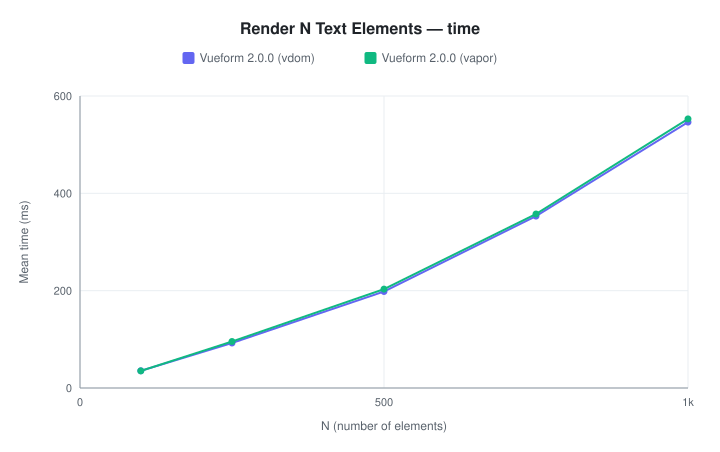
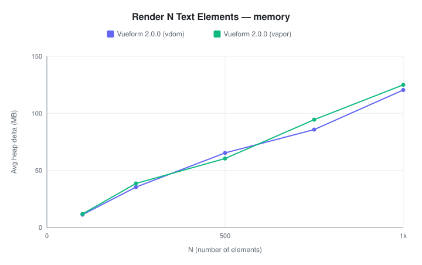
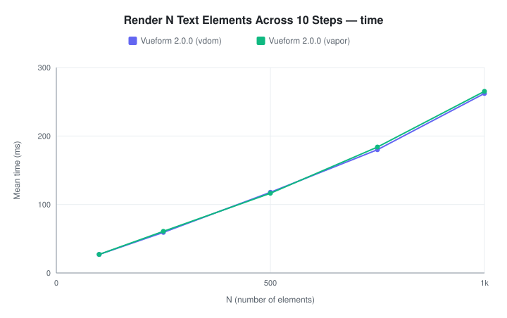
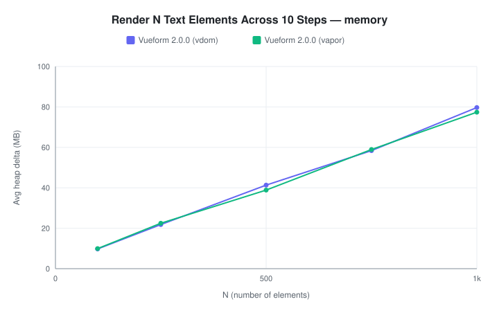
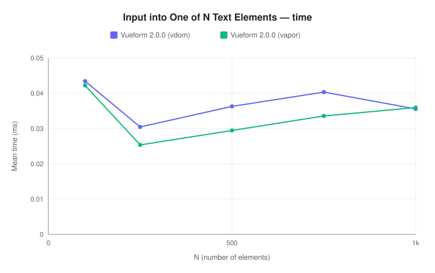
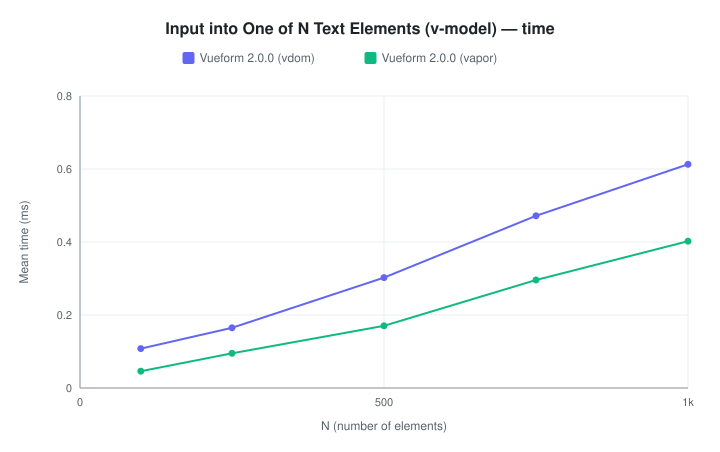
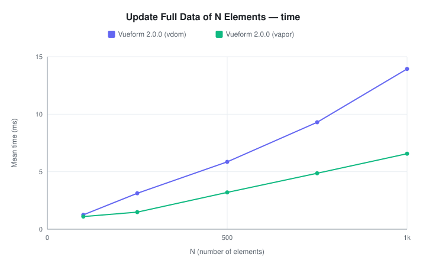
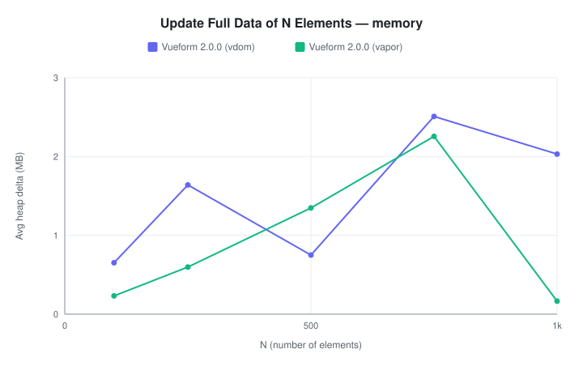

# Benchmark Results

Real browser measurements (Playwright + Chromium, production mode, Vue 3.6 runtime) of Vueform rendering performance as the number of elements N grows. Each case runs in both vdom and vapor mode.

*Last updated: 2026-09-18 13:47:40 UTC*

*Environment: Apple M5 · 16 GB RAM · macOS 26.6.2 · Chromium 151.0.7922.34 (headless) · Vue 3.6.0-rc.7 · Vueform 2.0.0*

## Render N Text Elements

Mounts a form whose schema contains N text elements.

<picture>
  <source media="(prefers-color-scheme: dark)" srcset="charts/render-text-time-dark.svg">
  
</picture>
<picture>
  <source media="(prefers-color-scheme: dark)" srcset="charts/render-text-memory-dark.svg">
  
</picture>

| N | Time — Vueform 2.0.0 (vdom) | Time — Vueform 2.0.0 (vapor) | vapor / vdom | Memory — Vueform 2.0.0 (vdom) | Memory — Vueform 2.0.0 (vapor) |
| --- | --- | --- | --- | --- | --- |
| 100 | 35.27 ms (±2.0%) | 35.20 ms (±2.0%) | ×1.00 | 11.24 MB | 11.87 MB |
| 250 | 92.50 ms (±0.9%) | 95.53 ms (±1.0%) | ×1.03 | 35.37 MB | 38.58 MB |
| 500 | 198.27 ms (±0.9%) | 203.21 ms (±1.2%) | ×1.02 | 65.35 MB | 60.43 MB |
| 750 | 353.20 ms (±0.9%) | 357.59 ms (±0.8%) | ×1.01 | 85.78 MB | 94.46 MB |
| 1000 | 546.27 ms (±0.9%) | 553.01 ms (±0.7%) | ×1.01 | 120.44 MB | 124.97 MB |

Details

|  | N | hz (ops/s) | Mean | Median | Min | Max | p75 | p99 | SD | RME | Samples |
| --- | --- | --- | --- | --- | --- | --- | --- | --- | --- | --- | --- |
| Vueform 2.0.0 (vdom) | 100 | 28.35 | 35.27 ms | 34.70 ms | 33.80 ms | 42.00 ms | 35.00 ms | 42.00 ms | 1.97 ms | ±2.00% | 30 |
| Vueform 2.0.0 (vdom) | 250 | 10.81 | 92.50 ms | 92.20 ms | 88.20 ms | 100.40 ms | 93.50 ms | 100.40 ms | 2.43 ms | ±0.94% | 30 |
| Vueform 2.0.0 (vdom) | 500 | 5.04 | 198.27 ms | 198.50 ms | 189.20 ms | 210.20 ms | 202.50 ms | 210.20 ms | 5.11 ms | ±0.92% | 30 |
| Vueform 2.0.0 (vdom) | 750 | 2.83 | 353.20 ms | 350.80 ms | 344.10 ms | 386.60 ms | 355.40 ms | 386.60 ms | 8.81 ms | ±0.89% | 30 |
| Vueform 2.0.0 (vdom) | 1000 | 1.83 | 546.27 ms | 543.30 ms | 534.30 ms | 561.30 ms | 557.60 ms | 561.30 ms | 9.37 ms | ±0.87% | 15 |
| Vueform 2.0.0 (vapor) | 100 | 28.41 | 35.20 ms | 34.50 ms | 34.20 ms | 42.60 ms | 35.10 ms | 42.60 ms | 2.00 ms | ±2.03% | 30 |
| Vueform 2.0.0 (vapor) | 250 | 10.47 | 95.53 ms | 96.70 ms | 89.70 ms | 99.60 ms | 97.50 ms | 99.60 ms | 2.63 ms | ±0.99% | 30 |
| Vueform 2.0.0 (vapor) | 500 | 4.92 | 203.21 ms | 204.80 ms | 186.70 ms | 216.70 ms | 206.00 ms | 216.70 ms | 7.09 ms | ±1.25% | 30 |
| Vueform 2.0.0 (vapor) | 750 | 2.80 | 357.59 ms | 355.60 ms | 343.90 ms | 376.20 ms | 361.30 ms | 376.20 ms | 8.11 ms | ±0.81% | 30 |
| Vueform 2.0.0 (vapor) | 1000 | 1.81 | 553.01 ms | 553.90 ms | 542.40 ms | 571.00 ms | 556.70 ms | 571.00 ms | 7.97 ms | ±0.73% | 15 |

## Render N Text Elements Across 10 Steps

Mounts a stepped form whose N text elements are split evenly across 10 steps. Elements on inactive steps defer their views to idle time, so the mount itself only renders the active step's N / 10 inputs; the rest stream into the DOM (hidden) after the form is interactive.

<picture>
  <source media="(prefers-color-scheme: dark)" srcset="charts/render-steps-time-dark.svg">
  
</picture>
<picture>
  <source media="(prefers-color-scheme: dark)" srcset="charts/render-steps-memory-dark.svg">
  
</picture>

| N | Time — Vueform 2.0.0 (vdom) | Time — Vueform 2.0.0 (vapor) | vapor / vdom | Memory — Vueform 2.0.0 (vdom) | Memory — Vueform 2.0.0 (vapor) |
| --- | --- | --- | --- | --- | --- |
| 100 | 27.05 ms (±0.7%) | 27.14 ms (±0.6%) | ×1.00 | 9.74 MB | 9.94 MB |
| 250 | 59.24 ms (±2.3%) | 60.85 ms (±2.2%) | ×1.03 | 21.80 MB | 22.47 MB |
| 500 | 117.83 ms (±2.0%) | 116.45 ms (±0.4%) | ×0.99 | 41.32 MB | 38.86 MB |
| 750 | 180.01 ms (±0.8%) | 183.88 ms (±0.5%) | ×1.02 | 58.40 MB | 58.93 MB |
| 1000 | 262.24 ms (±1.1%) | 265.23 ms (±0.8%) | ×1.01 | 79.70 MB | 77.41 MB |

Details

|  | N | hz (ops/s) | Mean | Median | Min | Max | p75 | p99 | SD | RME | Samples |
| --- | --- | --- | --- | --- | --- | --- | --- | --- | --- | --- | --- |
| Vueform 2.0.0 (vdom) | 100 | 36.97 | 27.05 ms | 27.10 ms | 25.70 ms | 28.70 ms | 27.20 ms | 28.70 ms | 0.52 ms | ±0.69% | 30 |
| Vueform 2.0.0 (vdom) | 250 | 16.88 | 59.24 ms | 56.60 ms | 55.20 ms | 64.80 ms | 63.40 ms | 64.80 ms | 3.75 ms | ±2.27% | 30 |
| Vueform 2.0.0 (vdom) | 500 | 8.49 | 117.83 ms | 115.30 ms | 107.50 ms | 144.10 ms | 121.50 ms | 144.10 ms | 6.45 ms | ±1.96% | 30 |
| Vueform 2.0.0 (vdom) | 750 | 5.56 | 180.01 ms | 182.40 ms | 174.00 ms | 183.50 ms | 183.00 ms | 183.50 ms | 3.85 ms | ±0.76% | 30 |
| Vueform 2.0.0 (vdom) | 1000 | 3.81 | 262.24 ms | 260.30 ms | 252.50 ms | 271.70 ms | 267.30 ms | 271.70 ms | 5.51 ms | ±1.06% | 15 |
| Vueform 2.0.0 (vapor) | 100 | 36.85 | 27.14 ms | 27.30 ms | 26.10 ms | 28.30 ms | 27.30 ms | 28.30 ms | 0.43 ms | ±0.57% | 30 |
| Vueform 2.0.0 (vapor) | 250 | 16.43 | 60.85 ms | 62.70 ms | 55.70 ms | 65.40 ms | 64.20 ms | 65.40 ms | 3.75 ms | ±2.21% | 30 |
| Vueform 2.0.0 (vapor) | 500 | 8.59 | 116.45 ms | 116.40 ms | 114.10 ms | 122.00 ms | 116.60 ms | 122.00 ms | 1.32 ms | ±0.40% | 30 |
| Vueform 2.0.0 (vapor) | 750 | 5.44 | 183.88 ms | 183.30 ms | 181.30 ms | 191.80 ms | 183.70 ms | 191.80 ms | 2.36 ms | ±0.46% | 30 |
| Vueform 2.0.0 (vapor) | 1000 | 3.77 | 265.23 ms | 267.70 ms | 259.80 ms | 271.20 ms | 269.00 ms | 271.20 ms | 4.34 ms | ±0.83% | 15 |

## Input into One of N Text Elements

Mounts a form with N text elements (untimed), then dispatches sequential native input events into the middle element. Times are the average of one input event (measured in batches of 250).

<picture>
  <source media="(prefers-color-scheme: dark)" srcset="charts/input-text-time-dark.svg">
  
</picture>

| N | Time — Vueform 2.0.0 (vdom) | Time — Vueform 2.0.0 (vapor) | vapor / vdom |
| --- | --- | --- | --- |
| 100 | 0.04 ms (±1.8%) | 0.04 ms (±1.9%) | ×0.97 |
| 250 | 0.03 ms (±1.9%) | 0.03 ms (±3.0%) | ×0.83 |
| 500 | 0.04 ms (±2.0%) | 0.03 ms (±3.6%) | ×0.81 |
| 750 | 0.04 ms (±8.4%) | 0.03 ms (±2.9%) | ×0.83 |
| 1000 | 0.04 ms (±21.3%) | 0.04 ms (±3.9%) | ×1.01 |

Details

|  | N | hz (ops/s) | Mean | Median | Min | Max | p75 | p99 | SD | RME | Samples |
| --- | --- | --- | --- | --- | --- | --- | --- | --- | --- | --- | --- |
| Vueform 2.0.0 (vdom) | 100 | 23027.33 | 0.04 ms | 0.04 ms | 0.04 ms | 0.05 ms | 0.05 ms | 0.05 ms | 0.00 ms | ±1.81% | 30 |
| Vueform 2.0.0 (vdom) | 250 | 32851.51 | 0.03 ms | 0.03 ms | 0.03 ms | 0.03 ms | 0.03 ms | 0.03 ms | 0.00 ms | ±1.88% | 30 |
| Vueform 2.0.0 (vdom) | 500 | 27563.40 | 0.04 ms | 0.04 ms | 0.03 ms | 0.04 ms | 0.04 ms | 0.04 ms | 0.00 ms | ±2.01% | 30 |
| Vueform 2.0.0 (vdom) | 750 | 24801.59 | 0.04 ms | 0.04 ms | 0.02 ms | 0.05 ms | 0.05 ms | 0.05 ms | 0.01 ms | ±8.39% | 30 |
| Vueform 2.0.0 (vdom) | 1000 | 28110.94 | 0.04 ms | 0.05 ms | 0.02 ms | 0.05 ms | 0.05 ms | 0.05 ms | 0.01 ms | ±21.30% | 15 |
| Vueform 2.0.0 (vapor) | 100 | 23689.20 | 0.04 ms | 0.04 ms | 0.04 ms | 0.05 ms | 0.04 ms | 0.05 ms | 0.00 ms | ±1.90% | 30 |
| Vueform 2.0.0 (vapor) | 250 | 39432.18 | 0.03 ms | 0.03 ms | 0.02 ms | 0.03 ms | 0.03 ms | 0.03 ms | 0.00 ms | ±3.00% | 30 |
| Vueform 2.0.0 (vapor) | 500 | 33952.01 | 0.03 ms | 0.03 ms | 0.02 ms | 0.03 ms | 0.03 ms | 0.03 ms | 0.00 ms | ±3.64% | 30 |
| Vueform 2.0.0 (vapor) | 750 | 29797.38 | 0.03 ms | 0.03 ms | 0.03 ms | 0.04 ms | 0.04 ms | 0.04 ms | 0.00 ms | ±2.93% | 30 |
| Vueform 2.0.0 (vapor) | 1000 | 27818.99 | 0.04 ms | 0.04 ms | 0.03 ms | 0.04 ms | 0.04 ms | 0.04 ms | 0.00 ms | ±3.92% | 15 |

## Input into One of N Text Elements (v-model)

Same as the plain input case, but the form has an active `v-model` (a real per-prop binding, as compiled `v-model` produces): every change snapshots the full model, emits it, and the parent writes it back into the binding. Times are the average of one input event (measured in batches of 250).

<picture>
  <source media="(prefers-color-scheme: dark)" srcset="charts/input-text-vmodel-time-dark.svg">
  
</picture>

| N | Time — Vueform 2.0.0 (vdom) | Time — Vueform 2.0.0 (vapor) | vapor / vdom |
| --- | --- | --- | --- |
| 100 | 0.11 ms (±4.2%) | 0.05 ms (±1.3%) | ×0.43 |
| 250 | 0.17 ms (±0.4%) | 0.10 ms (±0.5%) | ×0.58 |
| 500 | 0.30 ms (±0.4%) | 0.17 ms (±2.3%) | ×0.56 |
| 750 | 0.47 ms (±1.1%) | 0.30 ms (±1.3%) | ×0.63 |
| 1000 | 0.61 ms (±1.0%) | 0.40 ms (±1.5%) | ×0.66 |

Details

|  | N | hz (ops/s) | Mean | Median | Min | Max | p75 | p99 | SD | RME | Samples |
| --- | --- | --- | --- | --- | --- | --- | --- | --- | --- | --- | --- |
| Vueform 2.0.0 (vdom) | 100 | 9262.69 | 0.11 ms | 0.11 ms | 0.08 ms | 0.12 ms | 0.11 ms | 0.12 ms | 0.01 ms | ±4.24% | 30 |
| Vueform 2.0.0 (vdom) | 250 | 6060.12 | 0.17 ms | 0.16 ms | 0.16 ms | 0.17 ms | 0.17 ms | 0.17 ms | 0.00 ms | ±0.38% | 30 |
| Vueform 2.0.0 (vdom) | 500 | 3307.46 | 0.30 ms | 0.30 ms | 0.30 ms | 0.31 ms | 0.30 ms | 0.31 ms | 0.00 ms | ±0.39% | 30 |
| Vueform 2.0.0 (vdom) | 750 | 2119.18 | 0.47 ms | 0.48 ms | 0.44 ms | 0.51 ms | 0.48 ms | 0.51 ms | 0.01 ms | ±1.11% | 30 |
| Vueform 2.0.0 (vdom) | 1000 | 1631.50 | 0.61 ms | 0.61 ms | 0.59 ms | 0.65 ms | 0.61 ms | 0.65 ms | 0.01 ms | ±1.00% | 15 |
| Vueform 2.0.0 (vapor) | 100 | 21707.67 | 0.05 ms | 0.05 ms | 0.04 ms | 0.05 ms | 0.05 ms | 0.05 ms | 0.00 ms | ±1.29% | 30 |
| Vueform 2.0.0 (vapor) | 250 | 10511.56 | 0.10 ms | 0.10 ms | 0.09 ms | 0.10 ms | 0.10 ms | 0.10 ms | 0.00 ms | ±0.48% | 30 |
| Vueform 2.0.0 (vapor) | 500 | 5871.30 | 0.17 ms | 0.17 ms | 0.16 ms | 0.20 ms | 0.17 ms | 0.20 ms | 0.01 ms | ±2.33% | 30 |
| Vueform 2.0.0 (vapor) | 750 | 3380.51 | 0.30 ms | 0.30 ms | 0.27 ms | 0.31 ms | 0.30 ms | 0.31 ms | 0.01 ms | ±1.28% | 30 |
| Vueform 2.0.0 (vapor) | 1000 | 2487.07 | 0.40 ms | 0.40 ms | 0.37 ms | 0.43 ms | 0.40 ms | 0.43 ms | 0.01 ms | ±1.49% | 15 |

## Update Full Data of N Elements

Mounts a form with N text elements (untimed), then calls `form$.update()` with fresh values for all N fields. Times are the average of one full update (measured in batches of 10).

<picture>
  <source media="(prefers-color-scheme: dark)" srcset="charts/update-all-time-dark.svg">
  
</picture>
<picture>
  <source media="(prefers-color-scheme: dark)" srcset="charts/update-all-memory-dark.svg">
  
</picture>

| N | Time — Vueform 2.0.0 (vdom) | Time — Vueform 2.0.0 (vapor) | vapor / vdom | Memory — Vueform 2.0.0 (vdom) | Memory — Vueform 2.0.0 (vapor) |
| --- | --- | --- | --- | --- | --- |
| 100 | 1.25 ms (±8.1%) | 1.10 ms (±1.3%) | ×0.88 | 668.14 KB | 237.40 KB |
| 250 | 3.12 ms (±2.7%) | 1.49 ms (±1.0%) | ×0.48 | 1.64 MB | 612.62 KB |
| 500 | 5.86 ms (±0.4%) | 3.20 ms (±0.5%) | ×0.55 | 767.75 KB | 1.35 MB |
| 750 | 9.30 ms (±0.5%) | 4.87 ms (±0.6%) | ×0.52 | 2.51 MB | 2.26 MB |
| 1000 | 13.94 ms (±1.5%) | 6.56 ms (±0.6%) | ×0.47 | 2.03 MB | 169.44 KB |

Details

|  | N | hz (ops/s) | Mean | Median | Min | Max | p75 | p99 | SD | RME | Samples |
| --- | --- | --- | --- | --- | --- | --- | --- | --- | --- | --- | --- |
| Vueform 2.0.0 (vdom) | 100 | 801.28 | 1.25 ms | 1.15 ms | 1.04 ms | 1.98 ms | 1.16 ms | 1.98 ms | 0.28 ms | ±8.13% | 30 |
| Vueform 2.0.0 (vdom) | 250 | 320.41 | 3.12 ms | 3.20 ms | 2.39 ms | 3.27 ms | 3.22 ms | 3.27 ms | 0.24 ms | ±2.74% | 30 |
| Vueform 2.0.0 (vdom) | 500 | 170.77 | 5.86 ms | 5.85 ms | 5.71 ms | 5.95 ms | 5.93 ms | 5.95 ms | 0.07 ms | ±0.43% | 30 |
| Vueform 2.0.0 (vdom) | 750 | 107.55 | 9.30 ms | 9.27 ms | 9.16 ms | 9.86 ms | 9.35 ms | 9.86 ms | 0.13 ms | ±0.49% | 30 |
| Vueform 2.0.0 (vdom) | 1000 | 71.75 | 13.94 ms | 13.69 ms | 13.45 ms | 14.46 ms | 14.38 ms | 14.46 ms | 0.42 ms | ±1.51% | 15 |
| Vueform 2.0.0 (vapor) | 100 | 911.30 | 1.10 ms | 1.10 ms | 0.99 ms | 1.17 ms | 1.12 ms | 1.17 ms | 0.04 ms | ±1.26% | 30 |
| Vueform 2.0.0 (vapor) | 250 | 672.95 | 1.49 ms | 1.50 ms | 1.38 ms | 1.53 ms | 1.51 ms | 1.53 ms | 0.04 ms | ±1.01% | 30 |
| Vueform 2.0.0 (vapor) | 500 | 312.70 | 3.20 ms | 3.19 ms | 3.11 ms | 3.26 ms | 3.24 ms | 3.26 ms | 0.05 ms | ±0.54% | 30 |
| Vueform 2.0.0 (vapor) | 750 | 205.52 | 4.87 ms | 4.90 ms | 4.64 ms | 4.97 ms | 4.92 ms | 4.97 ms | 0.08 ms | ±0.56% | 30 |
| Vueform 2.0.0 (vapor) | 1000 | 152.38 | 6.56 ms | 6.56 ms | 6.45 ms | 6.68 ms | 6.62 ms | 6.68 ms | 0.08 ms | ±0.59% | 15 |

